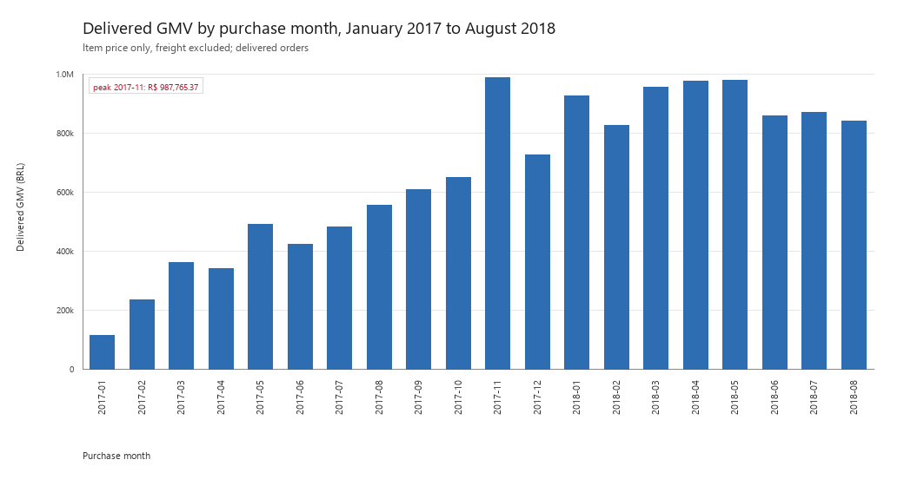
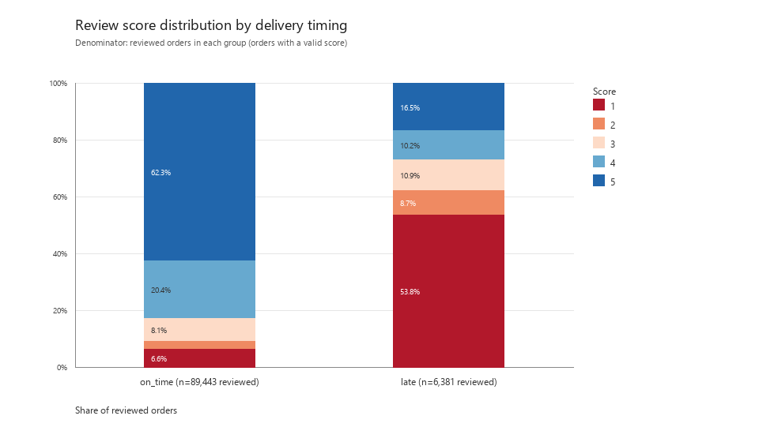

# Olist E-Commerce Analytics

An end-to-end analytics case study using the Olist Brazilian E-Commerce Public Dataset. The project examines marketplace performance, customer purchasing behavior, product and seller contribution, delivery operations, and customer feedback, then translates validated findings into business recommendations.

The work combines **SQL and Python**, with a documented business question and KPI framework. A
Power BI dashboard is planned as the next stage and is not part of the current results.

## Project at a Glance

| Area | Focus |
|---|---|
| Marketplace | Monthly delivered GMV, order volume, AOV and cancellation |
| Customers | Repeat purchasing and time to second purchase |
| Categories and sellers | Contribution and concentration of delivered GMV |
| Operations | Payment methods, installments, freight, delivery timing and reviews |
| Business intelligence | Metric definitions, data validation, reusable SQL, Python reproduction and Power BI reporting (upcoming) |
| Tools | MySQL, Python (pandas, Pillow), Power BI (upcoming), Git and GitHub |

## Business Questions

The analysis is structured around questions such as:

1. What share of observed buyers place more than one delivered order, and how long does a second purchase take?
2. How do delivery delays relate to review scores?
3. How does end-to-end delivery lead time vary by customer geography?
4. Which product categories contribute most to delivered merchandise value?
5. How do order values differ across payment installment groups?
6. How concentrated is delivered merchandise value among sellers?
7. How does the order cancellation rate change over time?
8. Which buyer–seller state combinations have longer delivery lead times?
9. How does freight compare with item value, and how does it relate to review scores?
10. Which observable order characteristics are associated with higher or lower review scores?

The full business context and analytical boundaries are documented in [Business Understanding](docs/01_business_understanding.md). Each question is answered in a detailed report under [reports/](reports/), and the cross-analysis view is in the [Executive Summary](reports/executive_summary.md).

## Data

The project uses the nine CSV tables in the public Olist dataset:

- Orders
- Order items
- Customers
- Products
- Payments
- Reviews
- Sellers
- Geolocation
- Product category translations

The raw dataset is not committed to this repository. Download it from the [Olist Brazilian E-Commerce Public Dataset on Kaggle](https://www.kaggle.com/datasets/olistbr/brazilian-ecommerce) and follow [Data Setup](data/README.md) for the local folder layout, the portable MySQL server and the import script.

**Important measurement boundary:** the dataset contains historical transaction and review records, not website or app event telemetry. It does not support direct measurement of conversion rate, add-to-cart rate, checkout abandonment, engagement-based active users, marketing attribution, or actual A/B test results. Any experiment design included in the project will be clearly identified as a proposal, not a completed experiment.

## Analytical Approach

The project follows a traceable workflow:

**Business question → Metric definition → Data validation → SQL/Python analysis → Insight → Recommendation**

1. Define the business problem and scope.
2. Understand source tables, relationships and analytical grain.
3. Validate keys, missingness, timestamps, numeric ranges and join behavior.
4. Build reusable SQL analysis at the correct grain.
5. Use Python for exploratory analysis, visualization and statistical checks.
6. Build a Power BI semantic model and dashboard from validated measures.
7. Communicate findings, limitations and recommendations.

See [Analytical Architecture](docs/04_analytical_architecture.md) and the [Analysis Roadmap](docs/05_analysis_roadmap.md).

## Repository Structure

```text
ecommerce-product-analytics/
├── README.md
├── requirements.txt
├── data/                      # setup instructions; raw CSVs stay local
│   └── README.md
├── docs/                      # context, definitions, validation, roadmap
│   ├── 01_business_understanding.md
│   ├── 02_dataset_dictionary.md
│   ├── 03_product_metrics.md
│   ├── 04_analytical_architecture.md
│   ├── 05_analysis_roadmap.md
│   └── data_validation_findings.md
├── sql/                       # read-only analytical queries
│   ├── data_exploration.sql
│   ├── order_level_dataset.sql
│   ├── marketplace_performance.sql
│   ├── customer_repeat_purchase.sql
│   ├── category_seller_performance.sql
│   ├── payments_and_freight.sql
│   ├── delivery_vs_reviews.sql
│   └── delivery_by_state.sql
├── python/                    # MySQL loader and Python reproduction
│   ├── load_mysql.py
│   ├── reproduce_analysis.py
│   └── README.md
├── scripts/                   # portable MySQL start and stop
│   ├── start-mysql.ps1
│   └── stop-mysql.ps1
├── powerbi/                   # upcoming
├── reports/                   # one report per analysis plus the executive summary
└── images/                    # generated charts
```

Directories will receive implementation artifacts as the corresponding analysis stages are completed.

## Headline Results

Each figure links to the report that produces and validates it. Denominators and limitations are
stated in each report and gathered in the [Executive Summary](reports/executive_summary.md).

| Finding | Figure | Source |
|---|---|---|
| Delivered merchandise value | R$ 13,221,498.11 across 96,478 delivered orders | [Marketplace Performance](reports/marketplace_performance.md) |
| Average order value | R$ 137.04 | [Marketplace Performance](reports/marketplace_performance.md) |
| Repeat buyers | 3.00% of 93,358 buyers placed 2+ delivered orders | [Customer Repeat Purchase](reports/customer_repeat_purchase.md) |
| 90-day repeat rate | 2.28% (1,717 of 75,439 eligible buyers) | [Customer Repeat Purchase](reports/customer_repeat_purchase.md) |
| Category concentration | top 10 of 74 categories = 62.43% of delivered GMV | [Category and Seller Performance](reports/category_seller_performance.md) |
| Seller concentration | top 5% of 2,970 sellers (149) = 53.06% of delivered GMV | [Category and Seller Performance](reports/category_seller_performance.md) |
| Payment mix | credit card = 78.34% of R$ 16,008,872.12 recorded payment value | [Payments and Freight](reports/payments_and_freight.md) |
| Late deliveries and reviews | 62.42% of late vs 9.27% of on-time reviewed orders scored 1-2 (53.15 pp gap) | [Delivery vs Reviews](reports/delivery_vs_reviews.md) |
| Buyer-state lateness | Alagoas 21.41% late (n=397) vs Sao Paulo 4.49% (n=40,494) | [Delivery by State](reports/delivery_by_state.md) |

## Charts





Both charts are generated by `python/reproduce_analysis.py`; see
[Python Reproduction](python/README.md) for the data behind them.

## Documentation

| Document | Description |
|---|---|
| [Business Understanding](docs/01_business_understanding.md) | Business context, questions, scope and limitations |
| [Dataset Dictionary](docs/02_dataset_dictionary.md) | Source tables, fields, grains and relationships |
| [Product Metrics & KPI Framework](docs/03_product_metrics.md) | Metric definitions, populations and calculation rules |
| [Analytical Architecture](docs/04_analytical_architecture.md) | Data flow, analytical entities, join controls and quality gates |
| [Analysis Roadmap](docs/05_analysis_roadmap.md) | Workstreams, implementation sequence and acceptance criteria |
| [Data Validation Findings](docs/data_validation_findings.md) | Row counts, keys, missingness, join coverage and resolved checks |

### Reports

| Report | Covers |
|---|---|
| [Executive Summary](reports/executive_summary.md) | Cross-analysis summary, denominators, limitations and next steps |
| [Marketplace Performance](reports/marketplace_performance.md) | Monthly delivered GMV, orders, AOV and cancellation |
| [Customer Repeat Purchase](reports/customer_repeat_purchase.md) | Repeat buyers, 90-day cohorts and time to second purchase |
| [Category and Seller Performance](reports/category_seller_performance.md) | Category and seller contribution and concentration |
| [Payments and Freight](reports/payments_and_freight.md) | Payment methods, installments, AOV groups and freight ratios |
| [Delivery vs Reviews](reports/delivery_vs_reviews.md) | Delivery timing and review scores |
| [Delivery by State](reports/delivery_by_state.md) | Buyer-state and seller-to-buyer state delivery timing |

## Reproduce the Analysis

**Prerequisites.** MySQL 8 with the `olist` schema loaded. See [Data Setup](data/README.md) for the
source files, the portable server and the import script.

```powershell
# 1. start the local MySQL server (portable install, runs without admin rights)
powershell -ExecutionPolicy Bypass -File scripts\start-mysql.ps1

# 2. create the schema and load the nine CSVs (first run only)
#    the loader reads its table definitions from sql/00_create_schema.sql
python python\load_mysql.py --create --load all

# 3. run a SQL analysis against MySQL
python python\load_mysql.py -f sql\marketplace_performance.sql
python python\load_mysql.py -f sql\delivery_vs_reviews.sql

# 4. install Python dependencies and reproduce two analyses with charts
pip install -r requirements.txt
python python\reproduce_analysis.py
```

The SQL analyses in [sql/](sql/) are read-only. `reproduce_analysis.py` recomputes the marketplace
and delivery-versus-reviews metrics in pandas and reconciles them against fresh runs of the
committed SQL; it exits non-zero and lists each discrepancy if anything differs.

## Project Status

| Stage | Status |
|---|---|
| Business scope, data dictionary, KPI framework, architecture and roadmap | Documented |
| MySQL schema, CSV import and data validation | Complete |
| Core SQL analyses (marketplace, customers, categories and sellers, payments and freight, delivery) | Complete, each with a report |
| Python reproduction and charts | Complete; reconciles to the SQL outputs |
| Power BI semantic model and dashboard | Upcoming |
| Experiment proposals and rollout decisions | Not started; recommendations are proposals to test |

## Dataset Source

Olist Brazilian E-Commerce Public Dataset — [Kaggle dataset page](https://www.kaggle.com/datasets/olistbr/brazilian-ecommerce).

## License and Data Use

Refer to the dataset provider's terms and license on Kaggle before redistributing the source files. This repository contains project documentation and analysis artifacts, not the raw dataset.
