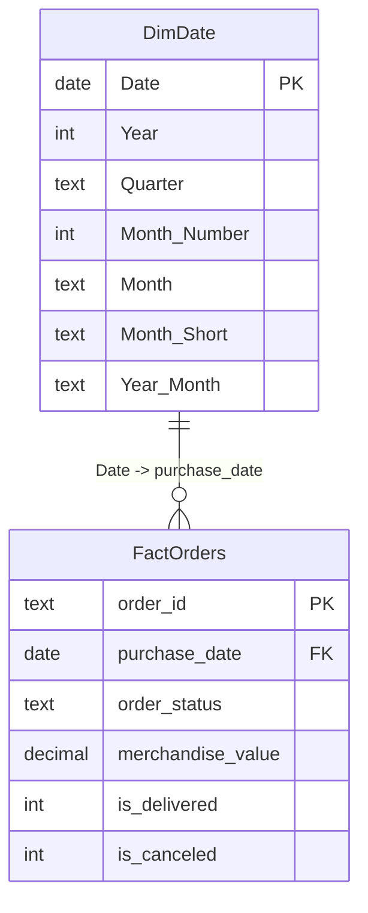

# Power BI milestone 1 — order-level semantic model

Builds the model that every dashboard page will sit on: one fact table at order grain,
one date dimension, one relationship, and five measures that match the committed SQL.

> **Status: specification complete, model-level checks pending.**
> Power BI Desktop is not installed on the machine used to prepare this branch, so the
> `.pbix` could not be created, opened or refreshed here. Everything below the model is
> verified against MySQL; the two model checks in [Verification](#verification) still have
> to be run in Desktop and their results recorded. [Actions for you](#actions-for-you)
> lists what to do.

## What was checked, and what was not

| Layer | How it was checked | Result |
|---|---|---|
| FactOrders source query | `python powerbi/validate_source.py` runs `powerbi/fact_orders.sql` against MySQL 8.0.44 | ✅ 9 of 9 checks matched |
| Source query stays in sync with `sql/order_level_dataset.sql` | `python powerbi/build_fact_orders_sql.py --check` | ✅ passes |
| Semantic model, relationship, DAX measures | Requires Power BI Desktop | ⏳ pending |

Desktop detection on this machine: no install under `C:\Program Files*\Microsoft Power BI
Desktop`, no `App Paths\PBIDesktop.exe` registry entry, no `PowerBI` Appx package, no Start
Menu shortcut, no `pbidesktop` protocol handler, and no `msmdsrv` process. `winget` could not
run in this session, so installing Desktop was not attempted — it needs an interactive
install and a signed-in user.

## Files

| File | Purpose |
|---|---|
| `fact_orders.sql` | FactOrders source query. **Generated** — do not edit by hand. Paste it as the MySQL native query. |
| `build_fact_orders_sql.py` | Regenerates `fact_orders.sql` from `sql/order_level_dataset.sql`; `--check` fails on drift. |
| `validate_source.py` | Runs the source query and asserts the values the five measures must return. |
| `measures.dax` | `DimDate` definition and the five measures, ready to paste. |

## Model design



**FactOrders** — import of `powerbi/fact_orders.sql`, 99,441 rows, one row per `order_id`,
every order status preserved. The query is the validated `sql/order_level_dataset.sql` body
with two changes only: it adds `purchase_date = DATE(order_purchase_timestamp)` and the
`olist.` qualifiers are removed so the query reads whichever database the connection selects.
The model therefore never silently falls back to `olist` when pointed at a copy of the schema.

| Column group | Columns | Notes |
|---|---|---|
| Keys and status | `order_id`, `customer_id`, `customer_unique_id`, `customer_state`, `order_status` | `order_id` is unique |
| Timestamps | `order_purchase_timestamp`, `order_approved_at`, `order_delivered_carrier_date`, `order_delivered_customer_date`, `order_estimated_delivery_date` | Date/Time |
| **Relationship key** | `purchase_date` | **Date** type, derived with `DATE()` |
| Flags | `is_delivered`, `is_canceled`, `is_delivery_duration_eligible` | Whole number |
| Items | `item_count`, `merchandise_value`, `freight_value`, `delivered_merchandise_value` | Money columns → Fixed decimal number |
| Payments | `payment_count`, `recorded_payment_value`, `invalid_installment_record_count`, `installment_group` |  |
| Reviews | `review_count`, `latest_valid_answer_timestamp`, `latest_review_score`, `order_review_status` |  |

**DimDate** — calculated table, `CALENDAR` from the minimum to the maximum `purchase_date`:
**774 rows**, 2016-09-04 to 2018-10-17, no gaps. Mark it as the date table so time
intelligence and the `Year-Month` sort work.

**Relationship** (one only):

| Setting | Value |
|---|---|
| From | `DimDate[Date]` (one side) |
| To | `FactOrders[purchase_date]` (many side) |
| Cardinality | One to many |
| Cross-filter direction | Single (`DimDate` → `FactOrders`) |
| Active | Yes |

`FactOrders` keeps its own timestamp columns for duration metrics, but `purchase_date` is the
only column that joins to the calendar.

## Measures

All five are in `measures.dax`. Format strings are set on the measure, not with `FORMAT()`.

| Measure | DAX | Format |
|---|---|---|
| Placed Orders | `COUNTROWS ( FactOrders )` | `#,##0` |
| Delivered Orders | `CALCULATE ( COUNTROWS ( FactOrders ), FactOrders[order_status] = "delivered" )` | `#,##0` |
| Delivered GMV (BRL) | `CALCULATE ( SUM ( FactOrders[merchandise_value] ), FactOrders[order_status] = "delivered" )` | `R$ #,##0.00` |
| Delivered AOV (BRL) | `DIVIDE ( [Delivered GMV (BRL)], [Delivered Orders] )` | `R$ #,##0.00` |
| Cancellation Rate | `DIVIDE ( CALCULATE ( COUNTROWS ( FactOrders ), FactOrders[order_status] = "canceled" ), [Placed Orders] )` | `0.00%` |

How these line up with the committed definitions:

- **Placed Orders** counts every row, so it includes all nine statuses. That is the
  denominator of the cancellation rate in `docs/03_product_metrics.md` §5.4.
- **Delivered GMV** sums `merchandise_value`, which is `SUM(order_items.price)` — freight is
  excluded, as required by §3.1 and by `sql/marketplace_performance.sql`.
- **Delivered AOV** is the numerator and denominator of the same filter context, matching
  §3.2 (`Delivered GMV / Distinct Delivered Orders`) instead of an average of averages. In
  the validated data every delivered order has items, so this equals the
  `delivered_orders_with_items` denominator used per month in the SQL report.
- **Cancellation Rate** is `canceled / placed`, kept as a fraction and displayed as a
  percentage, so 0.0062851 shows as `0.63%`.

## Actions for you

1. Install **Power BI Desktop** (Microsoft Store, or <https://powerbi.microsoft.com/desktop/>).
2. Start the local server: `powershell -ExecutionPolicy Bypass -File scripts\start-mysql.ps1`.
3. Follow [Build it in Desktop](#build-it-in-desktop) below — about 15 minutes.
4. Run both checks in [Verification](#verification) and fill in the "Actual" column.
5. Save as `powerbi/olist_order_model.pbix` and commit it (see [Credentials and
   refresh](#credentials-and-refresh)).

## Build it in Desktop

1. **Get data** → **More…** → **Database** → **MySQL database** → **Connect**.
2. Server `127.0.0.1:3306`, Database `olist`, data connectivity mode **Import**.
3. Expand **Advanced options**, paste the entire contents of `powerbi/fact_orders.sql` into
   **SQL statement**, then **OK**. The native query replaces the table picker, so no other
   table can sneak into the model.
4. In the credential dialog choose the **Database** tab, enter the MySQL user and password
   (`root` with an empty password on the local portable server), then **Connect**.
5. In the Navigator preview, tick the single result item and click **Load** (not *Transform
   Data*). Importing 99,441 rows takes a few seconds.
6. Fix the data types once, in **Transform data** if needed:
   `purchase_date` → **Date**; `merchandise_value`, `freight_value`,
   `delivered_merchandise_value`, `recorded_payment_value` → **Fixed decimal number**;
   `is_*`, `item_count`, `payment_count`, `review_count` → **Whole number**.
7. Rename the query and the table to **FactOrders**.
8. **Modeling** → **New table**, paste the `DimDate` block from `measures.dax`.
9. Select `DimDate` → **Table tools** → **Mark as date table** → column `Date`.
10. Drag `DimDate[Date]` onto `FactOrders[purchase_date]`. Double-click the line and confirm
    **one-to-many**, **single** cross-filter, **active**.
11. Select `FactOrders` → **New measure** → paste each of the five measures one at a time,
    setting its format string from the table above.
12. Optionally hide `FactOrders[purchase_date]` and the raw timestamp columns from the report
    view so report authors slice through `DimDate`.
13. **File** → **Save as** → `powerbi/olist_order_model.pbix`.

## Verification

### Check 1 — grain and all-date totals

- **Rows:** Data view → `FactOrders` grid. The status bar reports the row count; expect
  **99,441**.
- **Distinct order IDs:** in Data view turn on **Column profile** (View → Column profile),
  select `order_id`; the profile reports **Distinct 99,441**. (No extra measure needed, so the
  model keeps exactly five.)
- **Totals:** add a **Card** for each measure, or one Table visual with the five measures and
  no slicer.

| Measure | Expected | Actual (Desktop) |
|---|---:|---|
| Placed Orders | 99,441 | pending |
| Delivered Orders | 96,478 | pending |
| Delivered GMV (BRL) | R$ 13,221,498.11 | pending |
| Delivered AOV (BRL) | R$ 137.04 | pending |
| Cancellation Rate | 0.63% | pending |

### Check 2 — January 2018 through DimDate

Add a **Table** visual with `DimDate[Year-Month]` and the five measures, then filter the visual
to `Year-Month` = `2018-01` (or use a slicer on `DimDate[Year]` = 2018 and
`DimDate[Month Short]` = Jan). Filtering on `DimDate` proves the relationship is active.

| Measure | Expected, Jan 2018 | Actual (Desktop) |
|---|---:|---|
| Delivered Orders | 7,069 | pending |
| Delivered GMV (BRL) | R$ 924,645.00 | pending |
| AOV (BRL) | R$ 130.80 | pending |
| Placed Orders | 7,269 | pending |
| Cancellation Rate | 0.47% | pending |

The first two rows are the required checks; the last three are included because they come from
the same slice and cost nothing to confirm. All values match
`reports/marketplace_performance.md`.

### Source-layer results already verified

`python powerbi/validate_source.py` (MySQL 8.0.44, database `olist`) exits `0` and prints:

```
  rows in FactOrders                      99441  expected          99441  OK
  distinct order_id                       99441  expected          99441  OK
  Placed Orders                           99441  expected          99441  OK
  Delivered Orders                        96478  expected          96478  OK
  Delivered GMV (BRL)               13221498.11  expected    13221498.11  OK
  Delivered AOV (BRL)                    137.04  expected         137.04  OK
  Cancellation Rate (%)                    0.63  expected           0.63  OK
  Delivered Orders, Jan 2018               7069  expected           7069  OK
  Delivered GMV (BRL), Jan 2018       924645.00  expected      924645.00  OK

DimDate rows to create: 774 (2016-09-04 to 2018-10-17)
PASS all 9 source checks matched
```

This confirms the query, the grain and the arithmetic. It does **not** confirm the DAX, the
relationship or the model refresh — those are the pending Desktop checks above.

## Credentials and refresh

- **Nothing secret goes into Git.** Power BI stores data source credentials per user in
  Windows Credential Manager, keyed to the server/database pair; they are not written into the
  `.pbix` or `.pbip` file. Enter them once in the credential dialog (step 4) or later via
  **File** → **Options and settings** → **Data source settings** → **Edit permissions**.
- The project `.env` file is gitignored and is used only by the Python scripts; Power BI does
  not read it. Do not hardcode a password in a Power Query parameter, in a DAX formula or in
  this documentation.
- The committed `.pbix` contains imported data, not credentials. It is a binary file, so PR
  reviewers cannot diff it — review the generated SQL, the DAX and this document instead.
- **Refresh:** **Home** → **Refresh**. Import mode re-runs `fact_orders.sql` against MySQL, so
  the local server must be running. Scheduled refresh does not apply to a local server; it
  would require publishing to Power BI Service plus an on-premises data gateway.
- **Least privilege:** `root` with an empty password is only acceptable on a local, loopback-only
  server. For any shared machine, create a read-only account and grant it `SELECT` on `olist`
  only, as in the guard test used by `python/reproduce_analysis.py`.

## Keeping the source query in sync

`fact_orders.sql` is generated, never edited by hand:

```powershell
python powerbi\build_fact_orders_sql.py           # regenerate after changing sql/order_level_dataset.sql
python powerbi\build_fact_orders_sql.py --check   # fail if the two have drifted
python powerbi\validate_source.py                 # re-check the numbers against MySQL
```

If `sql/order_level_dataset.sql` changes, regenerate, run the validator, then refresh the
model in Desktop and re-run both checks.

The drift check compares content only, so it still passes after Git rewrites the file to CRLF
on a Windows checkout.

## Troubleshooting

| Symptom | Fix |
|---|---|
| "We couldn't find any data" / MySQL connector missing | Update Power BI Desktop; the MySQL connector ships with current versions. As a fallback install MySQL Connector/NET, or connect through ODBC with a MySQL 8 driver. |
| "The server was not found" | Start the portable server (`scripts\start-mysql.ps1`); it listens on `127.0.0.1:3306`. |
| Credentials rejected although `.env` works | The empty root password is a local convenience; set a real password and enter it in the credential dialog. |
| `DimDate` slicer does not filter the measures | The relationship is missing, inactive, or filters the wrong way. It must be `DimDate[Date]` → `FactOrders[purchase_date]`, single direction, active. |
| Jan 2018 filter shows more than 7,069 delivered orders | The slicer is on `FactOrders[order_purchase_timestamp]` instead of `DimDate`. Filter through `DimDate` so the check exercises the relationship. |
| AOV off by a few cents | The measure is dividing a rounded GMV. `[Delivered GMV (BRL)]` must stay unrounded in the model; only the display format rounds. |
